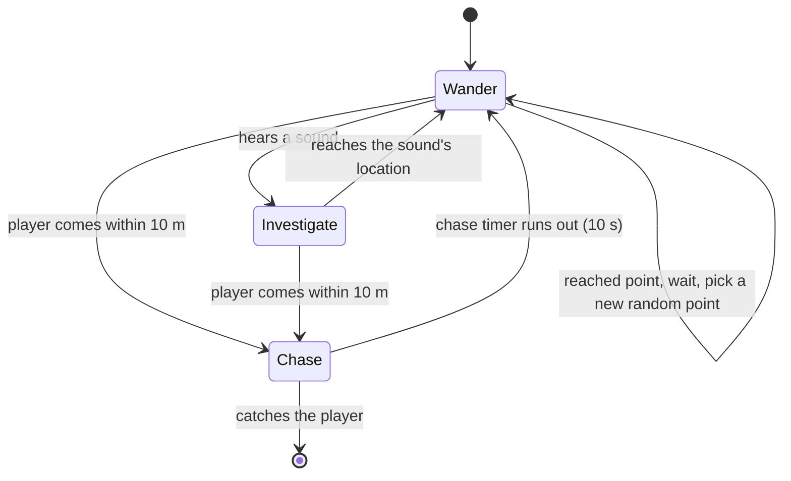

# Horror Game

**A first-person stealth horror game made in Godot 4, where a monster hunts you by sound while you search a dark maze for glowing gems.**

🎮 **[Download and play *Spoopy Game* on itch.io](https://clearcash.itch.io/horror-game)** (Windows, macOS, and Linux)

> [!WARNING]
> The Windows build on itch.io isn't working on my computer anymore, so it may not run for you either. The macOS and Linux builds should still run fine.

https://github.com/user-attachments/assets/71f6a1b2-c4dc-415e-a34a-044cc6d84617

> *In the eerie silence, a lurking predator awaits, attuned to the echoes of your every sound, as you navigate the shadows in a desperate bid for survival, collecting glowing gems to secure your escape.*

There are 11 gems hidden around the map. Collect all of them to escape. The monster can't see you from across the map, but it can **hear** you: sprint too long and it comes to investigate, get too close and it chases you down. Every gem you pick up makes noise and makes the monster faster, so the game gets harder the closer you are to winning.

The game is an early prototype I built to test ideas for a retro, PS1-style horror game.

---

## Gameplay

| Input | Action |
|-------|--------|
| W / A / S / D | Move |
| Mouse | Look around |
| Shift | Sprint (makes noise) |
| Left click | Toggle flashlight |
| R | Restart after dying |
| Esc | Quit |

---

## How it works

### Monster AI

The monster, called the Skinrunner, is controlled by a **finite state machine** and moves using Godot's **navigation mesh** pathfinding, so it walks around walls and through the maze instead of moving in a straight line.



- **Wander:** picks a random point in the level, snaps it to the nearest walkable spot on the navigation mesh, walks there, plays a feeding animation, then waits before picking the next point.
- **Investigate:** when the player makes too much noise, the monster walks to where the sound came from. After it finishes investigating, it can't hear anything new for a few seconds, which gives the player a chance to slip away.
- **Chase:** when the player enters the monster's detection radius, a "spotted" sound plays, the fog changes color and thickens, and after a 2 second delay the monster starts pathfinding toward the player's current position every frame. The chase only lasts 10 seconds, so a player who breaks away has a real chance to escape.
- **Kill:** if the monster gets within about 2 meters, the player dies.

### Sound system

The player has a **noise level** between 0 and 1. Sprinting slowly raises it, and walking or standing still lets it fall back down. Once it passes a threshold of 0.8, the player's position is sent to the monster as a sound to investigate. This means short sprints are safe, but sprinting for too long will give you away.

Picking up a gem also counts as a sound, so every pickup draws the monster toward you, and each one permanently increases the monster's speed by 2.

### Atmosphere and feel

- **Retro low-resolution rendering:** the game renders at 240 × 135 pixels and scales up to 1080p, giving it a chunky, PS1-style look that hides detail and makes the dark more unsettling.
- **Proximity camera shake:** the camera starts shaking when the monster is within 15 meters, and the shake gets stronger the closer it gets, so the player can feel it nearby even when they can't see it.
- **Dynamic fog:** volumetric fog fills the level, and its color and density change when the monster starts a chase.
- **Chromatic aberration shader:** a custom screen-space shader splits the red and blue color channels toward the edges of the screen for a distorted, uneasy look.
- **Glowing gems:** collectibles use a fresnel shader that makes their edges glow, so they stand out in the dark.
- **Random audio stingers:** an audio manager plays creepy sounds at random intervals of 10 to 30 seconds, so the player can never fully relax.
- **Player feel:** head bob while walking, hand and flashlight sway that follows mouse movement, footstep sounds that change when sprinting, and heavy breathing while running.

---

## Project structure

```
Horror-Game/
├── project.godot
├── scenes/             # World, player, monster, collectibles, menus, death and end screens
├── scripts/
│   ├── player.gd           # Movement, sprinting, noise level, flashlight, head bob
│   ├── skinrunner.gd       # Monster state machine and navigation
│   ├── world.gd            # Game loop: spawning, win/lose, camera shake, gem counter
│   ├── collectro.gd        # Gem pickup
│   ├── Audio Manager.gd    # Random ambient stingers
│   ├── Hand.gd             # Hand and flashlight sway
│   └── main_menu.gd, death_screen.gd, end_screen.gd
├── shaders/            # Chromatic aberration, gem glow, static overlay
├── model/              # Monster, flashlight, player arms, and level models
└── textures/           # Level textures
```

---

## Running the game

1. Install [Godot 4.3](https://godotengine.org/download/) (the standard version, not .NET).
2. Clone the repo:
   ```bash
   git clone https://github.com/Akshajk3/Horror-Game.git
   ```
3. Open Godot, click **Import**, and select the `project.godot` file.
4. Press **F5** to play from the main menu.

Or skip the setup and download a ready-to-play build from [itch.io](https://clearcash.itch.io/horror-game). (The Windows build may not work; see the warning at the top.)

> [!NOTE]
> **The game's sound files were lost and are not included in this repo.** The scenes still reference about 55 audio files in a `sounds/` folder (footsteps, breathing, the monster's footsteps and "spotted" sound, ambient drones, random stingers, the heartbeat, the death scream, and the flashlight and pickup sounds), so Godot will show missing-resource errors when the project opens, and the game has no sound. Since so much of the game depends on audio (the stealth mechanic is built around sound), the best way to play is the [itch.io build](https://clearcash.itch.io/horror-game), which was exported before the files were lost and still includes all the original audio.


---

## Credits

**3D models**
- *Scab* monster model by [Max Damage](https://maximumdamage.itch.io), used under the [Max Damage asset license](https://mygamedesignscom.wordpress.com/license-for-all-uses-of-my-assets/)
- [*Chaotic Plague*](https://sketchfab.com/3d-models/chaotic-plague-96452217e8fb457da53818a241f41ed5) by [Apollo Nickolas](https://sketchfab.com/apollonickolas.play), licensed under [CC BY 4.0](http://creativecommons.org/licenses/by/4.0/)
- [*Flash Light Psx | Low Poly*](https://sketchfab.com/3d-models/flash-light-psx-low-poly-1a7235fad65646a9bafb21bc7c40467a) by [liltoba](https://sketchfab.com/liltoba), licensed under [CC BY 4.0](http://creativecommons.org/licenses/by/4.0/)
- Character animations from [Mixamo](https://www.mixamo.com/)

**Shaders**
- Static overlay shader by [Jordancjb](https://linktr.ee/jordancjb), CC0

**Sound effects** (the files are no longer in the repo; see the note in [Running the game](#running-the-game))
- The original game used sounds from the *Horror SFX Free*, *Japanese-Style Horror SFX*, *Underground Facility Ambient Pack*, and *Footsteps Rock* sound packs, plus individual heartbeat and footstep sounds
- "Spotted" sound effect made by me in Audacity
